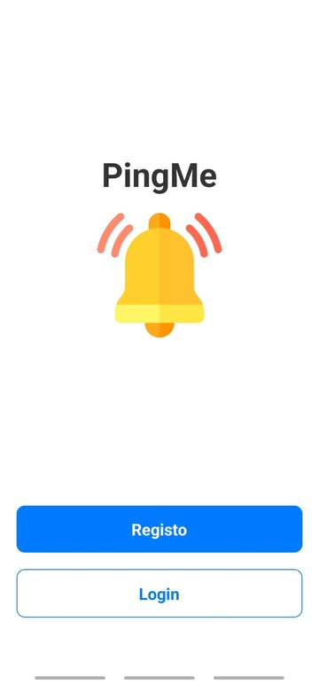
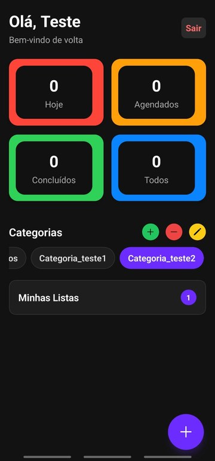
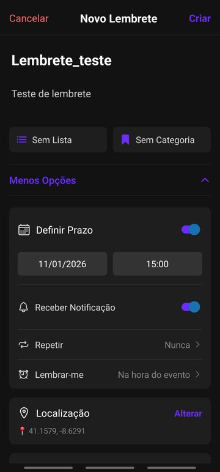
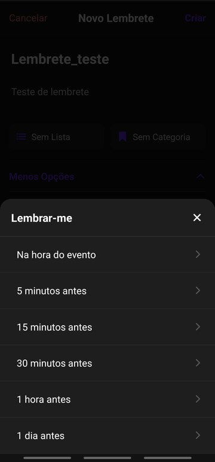
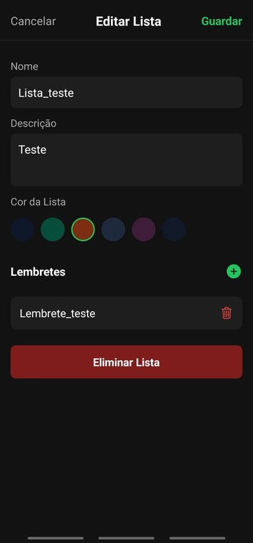
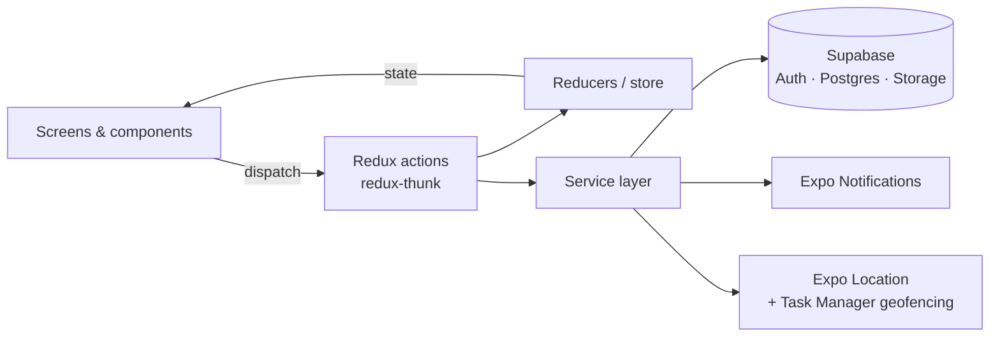

# PingMe — Smart Reminders App

A cross-platform mobile app (React Native + Expo) for managing reminders, lists and categories, with **time-based** and **location-based** notifications, backed by **Supabase**.

> Developed for the Mobile Systems course (DSSMV) of the Telecommunications and Computer Engineering degree at ISEP. The app's UI is in Portuguese.
> This repository is a cleaned-up copy of the original (private) course repository; the commit history was not carried over.

<p align="center">
  
  
  
  
  
</p>

## Features

- **Accounts** — sign-up and login with Supabase Auth; reminders, lists and categories are stored per user.
- **Reminders** — title, notes, deadline, priority, category, list and an optional photo (camera or gallery, stored in Supabase Storage).
- **Time-based notifications** — scheduled local notifications with a configurable lead time (at the event, 5/15/30 min, 1 h or 1 day before) and repetition (daily, weekly, monthly, yearly).
- **Location-based notifications** — pick a place on a map and get notified when you arrive there (background **geofencing**, 100 m radius).
- **Lists and categories** — colour-coded lists, category filters and a dashboard with *Today / Scheduled / Completed / All* counters.

## Architecture



- **State management:** Redux with thunks; data operations go through actions and the service layer.
- **Service layer:** `services/` hides each backend behind an interface (`services/interfaces.ts`), with Supabase implementations for auth, reminders, lists and categories.
- **Device services:** notification scheduling (calendar and date triggers) and background geofencing run in dedicated services.

## Tech stack

React Native 0.81 · Expo SDK 54 · TypeScript · Redux + redux-thunk · React Navigation · Supabase (Auth, Postgres, Storage) · expo-notifications · expo-location · expo-task-manager · react-native-maps

## Project structure

```
├── App.tsx                 # Redux provider + navigation
├── navigation/             # Stack navigator
├── screens/                # auth, home, reminders, lists, categories
├── components/             # Reusable UI components
├── redux/                  # actions, reducers, store, types
├── services/               # Supabase, notification and location services
└── docs/analysis/          # Requirements, domain model, use cases (PlantUML)
```

## Running locally

1. Install dependencies: `npm install`
2. Create a Supabase project and copy `.env.example` to `.env` with your project URL and anon key.
3. Start the app: `npx expo start` and open it in Expo Go or an emulator.

> Location-based reminders rely on background location, which requires a development build on a real device.

## Documentation

Requirements, domain model, use-case diagram and system sequence diagrams are in [`docs/analysis`](docs/analysis) (PlantUML).
